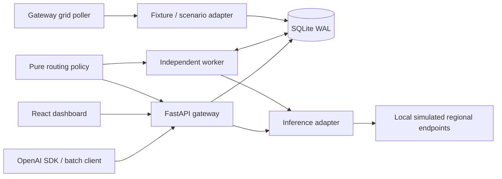

# GreenRoute architecture and boundaries

GreenRoute is a single-host, regional-grid-aware inference demonstrator. The API, worker and mock provider are separate processes sharing one SQLite database. The default demo simulates inference, grid signals and token usage; the energy coefficient is illustrative. An isolated live runtime connects reviewed vLLM deployments and Electricity Maps using a separate database, immutable manifest identity and explicit provenance. See [live integration](live-integration.md).

## Code map

| Location | Responsibility |
|---|---|
| `backend/greenroute/app.py` | Authenticated HTTP contracts, interactive dispatch, metadata and built dashboard |
| `contracts.py`, `config.py` | Strict payload/policy schemas and validated environment settings |
| `policy.py` | Pure eligibility, threshold, tie-breaking and deadline decisions |
| `grid.py`, `clock.py`, `scenarios.py` | Timestamped observations, cache/polling, deterministic clocks and persistent demo signals |
| `jobs.py`, `store.py`, `migrations/` | Admission/idempotency, owner access, cancellation, retention and schema |
| `worker.py` | Claims, leases/renewal, attempts, recovery, safe retries and scheduling |
| `inference.py`, `endpoint_health.py` | Bounded HTTP calls, failure classification and persisted circuit health |
| `estimation.py` | Immutable dispatch assumptions, per-execution estimates and segregated aggregates |
| `mock.py` | Normal demo provider; optional synthetic delay, no failure-control endpoints |
| `frontend/src/` | Runtime credential entry, metadata polling, queue/evidence views and demo controls |
| `examples/` | SDK, asynchronous submission and resumable synthetic replay clients |
| `scripts/`, `verification/` | Isolated verification/rehearsal and test-only fault service factories |

Paths in the table after the first row are relative to `backend/greenroute/` unless a directory prefix is shown.

## Transaction boundaries

Admission uses `BEGIN IMMEDIATE` to check owner/key/body identity and capacity, then persist a new job before returning 202. A same-key lookup precedes the new-job deadline check so an accepted identity remains retrievable after its deadline, within the 24-hour mapping window.

A claim serializes eligibility and cancellation, records the exact dispatch decision, increments the attempt and reserves a running lease with a random owner token. There is no provider network call inside that transaction. Cancellation succeeds only before this dispatch transition.

Completion requires the same owner token and an unexpired running lease. Attempt, job result/state and estimate are committed together. An expired running lease becomes unknown; it is not requeued. This provides durable state and prevents simultaneous local claims, while deliberately avoiding an exactly-once provider execution promise.

## Routing and estimates

Interactive calls use configured healthy endpoint order immediately. The rank is an operator preference, not measured geographical latency discovery. Flexible jobs first enforce model/version, allowed regions, health and locality, then optimize eligible fresh intensity. Waiting ends through a qualifying signal, explicit cancellation or the chosen deadline policy.

The comparison is spatial at dispatch time. It uses a fixed eligible default endpoint, the selected endpoint, the same snapshot interval and one versioned energy model. Missing evidence excludes the comparison; negative differences remain negative. Retained assumptions are independent of later configuration changes. No temporal benefit, failed-attempt energy, cooling, networking or embodied impacts are added.

## Operational boundaries

The gateway owns grid polling. If it stops, the worker can finish dispatched calls but cached signals eventually become stale. The worker owns lease recovery and cleanup. If it stops, pending work stays durable and cleanup waits for a worker restart.

Defaults permit ten active worker jobs plus ten interactive requests per gateway. The benchmark measures ten interactive lanes and a separate ten-job worker drain, not simultaneous saturation of both pools. SQLite WAL, local disk and one worker are the supported deployment; no multi-host availability claim is made.

Live inference requires separate endpoint locality/model evidence, grid entitlement and energy calibration. The normal services bind to loopback in documented commands. Remote TLS, enterprise identity, production tenant isolation and availability remain outside the verified scope.

## Runtime identity and eligibility

Migration 005 binds each database to demo or live mode. Live initialization requires an empty
migrated database, reviewed regional locality/model equivalence and an explicit fixed baseline.
The registry stores evidence references and equivalent model revisions, while secrets remain in
environment variables. Gateway and worker validate registry metadata and a canonical manifest
digest; operational circuit state is independent of approval. A process keeps its approved
manifest in memory; manifest changes require a new isolated registry/database and process restart.

The policy receives the expected mode/model revision, so freshness checks reject the other
mode's observations. Cache reads also filter by mode. Successful live executions label usage as
provider reported; captured estimation assumptions retain the actual configured model revision.
The demo dashboard is served only in demo mode. Live inspection uses mode-labeled JSON APIs.
